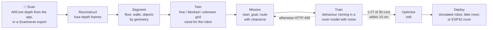
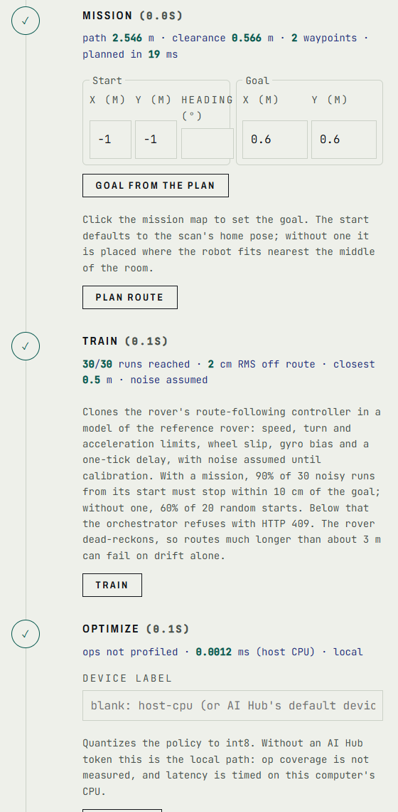

<div align="center">


# ScanBorn

### Scan a room with a phone. Train a robot's controller in a model of that room. Let it drive only after it passes.

[](LICENSE)


</div>

---

ScanBorn turns a phone scan of a room into a map of where a small two-wheel robot fits. The operator
picks a start and a goal, ScanBorn plans a route that keeps the robot's clearance, trains the
robot's route-following controller in a simulation of that robot, and refuses to hand over a
controller that does not reach the goal in simulation. A controller that passes is quantized to int8
and sent to the robot, which runs the control loop itself.

Everything runs on a laptop CPU and a phone, with no cloud service in the loop.

## Status

| Part | State |
|---|---|
| Orchestrator (REST API, SQLite), reconstruction, segmentation, navmesh, missions, simulation, training, int8 export | **Works**, tested |
| Dashboard: operator console, mission map, live 3D view, E-STOP | **Works**, browser-tested against a fake rover |
| Rover protocol and a fake rover that speaks it | **Works**, tested |
| ESP32 rover firmware | Compiles; its self-test passes on an emulated ESP32. **Not yet run on a board — the rover is not built** |
| Phone app: on-device chat, voice, OCR, PDF summaries | **Works** on a Galaxy S24 FE |
| Phone app: room scan | Built and unit-tested; **not yet run on the phone** |
| Scans used in tests and checks | Synthetic rooms, and generated PLY/OBJ files for the Scaniverse import; **no scan from the app yet** |

What ScanBorn does **not** use: reinforcement learning (PPO), Unity or ML-Agents, Whisper, or any
NPU. The phone is an Exynos device and every model here runs on a CPU.

> **Earlier version.** ScanBorn started at the Snapdragon Multiverse Hackathon (Noida, July 2026)
> with a different architecture: a Snapdragon phone, Unity ML-Agents, an Arduino UNO Q and the
> Hexagon NPU. The [hackathon presentation](https://drive.google.com/file/d/1FVmkK1D10T_MoZQ3SAYPb0TuvyM9fdCo/view?usp=sharing)
> and [demo videos](https://drive.google.com/drive/folders/1pjukNdoxKCu7rjAIrVEtiGQ_cdr1rQQN?usp=sharing)
> show that version, and `detailed implementation doc.md` is its design. The code in this
> repository has moved on; this README describes the code.

---

## The loop



1. **Scan.** Tape the printed marker (`docs/capture/home-marker.svg`) to the floor, stand on it
   pointing along its arrow and scan with the app. The marker becomes the map's origin, and the same
   marker is where the rover starts. A finished `.ply` / `.obj` from Scaniverse also works.
2. **Reconstruct.** Depth frames are fused into one point cloud, keeping surfaces that at least two
   frames saw.
3. **Segment.** The floor is found as a slab; the rest is clustered and labelled by shape (wall,
   table, chair, shelf). No model weights are needed.
4. **Twin.** The cloud becomes a grid of free, blocked and never-scanned cells at 5 or 10 cm,
   chosen from how densely the floor was scanned. Never-scanned floor is not drivable.
5. **Mission.** A start and a goal (clicked on the map or typed) become a route that keeps the
   robot's clearance, or a refusal that says why.
6. **Train.** The rover's pure-pursuit controller is cloned into a small linear policy, then driven
   30 times along the mission in a model of the rover with speed and turn limits, wheel slip, gyro
   drift, a control delay and placement error. Fewer than 27 of 30 runs stopping within 10 cm of the
   goal is a refusal (HTTP 409). The noise values are assumptions until the rover is calibrated.
7. **Optimize.** The policy is quantized to int8 and timed on the laptop CPU.
8. **Deploy.** To the simulated robot, or to a rover over the rover protocol
   (`docs/robot/rover-protocol.md`): the orchestrator loads the mission, starts it and relays
   telemetry; the rover runs the control loop itself, stops on a lost heartbeat, and can be stopped
   from the console (Space is E-STOP).

A rescan of the same room (`POST /sync`) reports what changed and marks any mission whose route is
no longer safe as stale; a stale mission cannot be deployed.

---

## Screenshots

These come from `scripts/check_live_drive.py`, which drives the real console in headless Chrome on
the test suite's synthetic room (not a scan) with the fake rover.


*The mission map: the planned 2.5 m route, the simulated drive, and the fake rover's reported
position from the check's last drive, which was stopped with E-STOP soon after it started.*


*The 3D view after a fake-rover drive: planned route and the trace the rover reported.*



*Mission, train and optimize in the console. "Noise assumed" and "ops not profiled" are what the
orchestrator reports: nothing is calibrated or profiled yet.*

---

## Measured so far

| What | Result | Conditions | Source |
|---|---|---|---|
| On-phone model, first token | 5.3 s | Galaxy S24 FE, Qwen2.5-1.5B-Instruct Q4_K_M, 359-token prompt, 6 threads, weight repacking on; single runs | `benchmarks/phone.json` |
| On-phone model, prefill | 69.0 tok/s (46.8 with repacking off) | as above | `benchmarks/phone.json` |
| On-phone model, 256-token reply | 19.0 s | as above | `benchmarks/phone.json` |
| Route planning, 5 cm grid | p50 15 ms, p95 37 ms | synthetic 12 × 10 m furnished room, 20 missions, i5-13450HX | `benchmarks/planning.json` |
| Simulated arrival within 10 cm vs route length | 2.5 m: 30/30 · 3.7 m: 25/30 · 4.6 m: 23/30 | rover model with assumed noise; the rover dead-reckons, so long routes drift | master plan, Phase 3 decision 14 |

Not measured yet: anything on the real rover, anything from a scan made with the app, and the
policy on an NPU (there is none).

---

## Hardware

| | Role |
|---|---|
| **Samsung Galaxy S24 FE** (Exynos 2400e, 8 GB) | Scanning (ARCore raw depth) and the on-device language model |
| **Laptop** (the project's: Lenovo LOQ, i5-13450HX) | Orchestrator and every pipeline stage, on the CPU; no GPU needed |
| **ESP32 two-wheel rover** (to be built) | ESP32 DevKit, 2 × JGB37-520 motors with encoders, MPU6050, VL53L0X; parts list and pin map in the master plan §4.3–4.4 |

---

## Run it

Python 3.10+ and Node.js 20.19+ (or 22.12+).

```bash
git clone https://github.com/Aditya060806/ScanBorn.git
cd ScanBorn
pip install -e . -r requirements-dev.txt
```

**Orchestrator** (every pipeline stage, one process):

```bash
python -m uvicorn orchestrator.service:app --port 8000
```

Add `--host 0.0.0.0` when the phone or a rover must reach it, and allow port 8000 (and UDP 5005
for rover telemetry) through the firewall. `docker compose -f docker/docker-compose.yml up --build`
runs the same orchestrator in a container; that image has not been built and run yet.

**Optional remote providers.** Everything above runs locally with no configuration. Task planning
(`SCANBORN_PLANNER=groq,local`), environment profiling (`SCANBORN_PROFILER=groq,local`) and an
export experiment (`SCANBORN_EXPORT=ai-hub|qairt`) can be switched on explicitly — see
`.env.example`. An API key alone never selects a provider, an unknown name is refused before the
stage runs, and every result records which provider answered, where it ran and why any fallback
happened. Every plan, local or remote, passes the same contract: a target that is not in the scan
or is shared by two objects is a question for the operator, never a guess. `GET /providers` shows
each workload's chain, limits and today's remote usage. Export experiments are recorded beside the
int8 bundle but never deployed: the rover runs only `npz-int8`.

The dashboard's **Processing providers and privacy** panel and Android Spaces provider controls
can save ordered provider choices. Explicit consent names the outgoing data before remote choices
can be saved; credentials stay on the server. Saved choices in the configured data directory's
`provider-settings.json` override the environment defaults for subsequent stages. Use **Use local
providers for all stages** to return to local processing. Running requests retain their selection.

For a separate, versioned simulated release check, run
`python scripts/evaluate_release.py --policy PATH --artifact PATH --spec rover --out NEW_REPORT.json`.
It evaluates the float policy and actual exported int8 bundle with paired reserved seeds, 100 runs
per traversable case, a 90% success minimum and zero collisions, plus blocked-route refusals.
Reports include checksums, robot assumptions, per-run samples and p95 miss distance. This report
does not replace the mission deployment gate or physical measurements; reserve its scenes and seeds
from training and tuning.

The local planner's understanding is measured on a frozen intent set (`datasets/intents/`,
`benchmarks/intents-local-v1.json`): 16 of 16 English plans correct, every ambiguous, off-scene or
unsupported instruction refused, Hindi not understood (it abstains), and no wrong or unsafe plan.
Remote planners have not been scored.

**Dashboard** (landing page at `/`, operator console at `/dashboard`):

```bash
cd dashboard
npm install
npm run dev
```

With no scan at hand, `python scripts/seed_synthetic_scans.py` uploads the tests' synthetic room and
prints a scan id to type into the console. **Load offline fixture** replays a recorded run with no
orchestrator.

**Python SDK** — the whole loop in one call (run from the repository root, orchestrator running):

```python
from scanborn import ScanBorn
from tests.test_orchestrator import scan_frame   # the synthetic room the tests use

sb = ScanBorn("http://localhost:8000")
run = sb.run_pipeline([scan_frame()], text="go to the table",
                      start=(-1.2, -1.2), goal=(0.6, 0.6))
print(run["sim_success_rate"], run["deployment_id"])
```

**Phone app:** see [`MOBILE-APP/README.md`](MOBILE-APP/README.md) (the model file, the build, and
setting the orchestrator's address).

**Firmware:** `firmware/scanborn_rover/` (Arduino, ESP32 core 3.x). `nox -s firmware` builds it,
`nox -s firmware_host` runs its maths against golden vectors on the laptop, and `nox -s
firmware_qemu` runs its self-test on Espressif's ESP32 emulator; the environment variables they need
are in `noxfile.py`.

---

## Tests and checks

```bash
python -m pytest -q
python -m flake8 sdk orchestrator capture reconstruction semantic robot sarvam twin policy deployment tests scripts noxfile.py
python -m mypy sdk orchestrator capture reconstruction semantic robot sarvam twin policy deployment tests
cd dashboard && npm test && npm run build
python scripts/check_live_drive.py    # orchestrator and dashboard running; needs Chrome or Edge
```

CI (GitHub Actions) runs lint, type checks, tests on Python 3.10–3.12, and bandit. The Android app
has JVM unit tests (`./gradlew :app:testDebugUnitTest`); its screens are checked by hand.

---

## Repository

```text
orchestrator/      REST API (FastAPI), SQLite store, jobs, rover deployment sessions
capture/           scan storage and Scaniverse import
reconstruction/    depth fusion, floor estimate
semantic/          geometric segmentation (YOLO-World used only if installed)
twin/              navmesh grid, environment profiles, scene manifest
policy/            route planning, rover simulation, controller, behaviour cloning, evaluation gates
robot/             rover spec, rover protocol, adapters (simulated, rover), fake rover
sarvam/            task planning from text: offline keyword planner, optional remote planners
deployment/        int8 export; optional Qualcomm AI Hub path (needs a token and a Snapdragon target)
sdk/scanborn/      Python client for every route
dashboard/         React + Vite: landing page and operator console
MOBILE-APP/        Android app (Kotlin, Compose, ARCore, llama.cpp)
firmware/          ESP32 rover firmware
scripts/           fixtures, benchmarks, browser and scan checks
docs/              API (OpenAPI), rover protocol, capture marker, hardware notes, plans
benchmarks/        measured numbers, each with how it was measured
experiments/       the hackathon's Snapdragon RC-buggy experiment, kept for the record
docker/            orchestrator image
```

Where the project is and what comes next: `docs/superpowers/START-HERE.md`. The plan:
`docs/superpowers/plans/2026-09-13-scanborn-scan-to-drive-plan.md`.

---

## Team

| Name | Role |
|---|---|
| Aditya Pandey | AI & Reinforcement Learning and Edge-AI & Embedded Systems |
| Adhishvar Singh | Robotics & Autonomous Systems |
| Palak Rai | Full-Stack & Cloud Infrastructure |

Contact: aditya060806@gmail.com

## License

MIT — see [`LICENSE`](LICENSE). Third-party components and their licences:
[`docs/THIRD_PARTY_LICENSES.md`](docs/THIRD_PARTY_LICENSES.md).

## Citation

```bibtex
@software{ScanBorn2026,
  title={ScanBorn: From a Phone Scan to a Simulation-Gated Robot Controller},
  author={Team Ghost Map},
  year={2026},
  url={https://github.com/Aditya060806/ScanBorn}
}
```
