<div align="center">

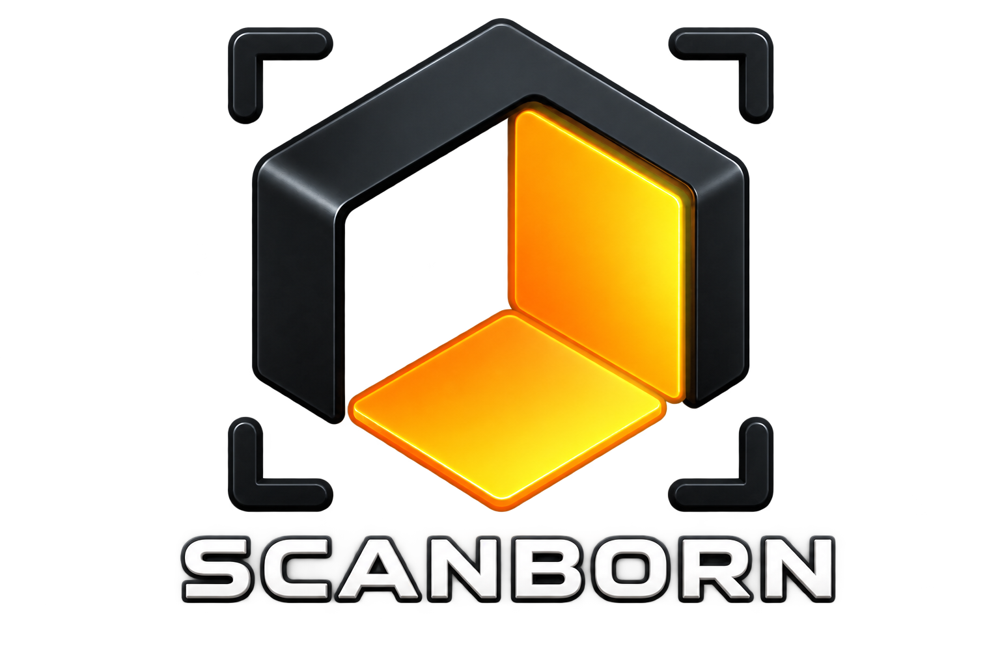

# ScanBorn

### From a room scan to a simulation-validated rover mission.

**Capture · Reconstruct · Inspect · Plan · Train · Validate · Deploy · Measure**

[](LICENSE)


[Visual tour](#visual-tour) · [Quick start](#quick-start) · [Architecture](#architecture) · [3D workspace](#the-shared-3d-workspace) · [Benchmarks](#benchmarks-and-performance) · [Verification](#verification) · [Roadmap](#limitations-and-future-scope)

</div>

---

<p align="center">
  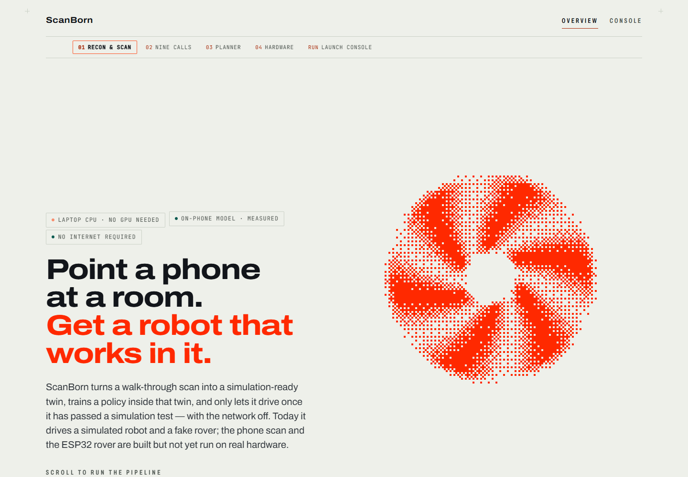
</p>

<p align="center"><em>The current website, captured 22 September 2026. Landing geometry is illustrative; the operator workspace loads reconstruction data.</em></p>

## Overview

ScanBorn connects environment capture, spatial inspection, robot-specific planning, controller training and deployment in one software workflow. Scan a room with an Android phone—or import a PLY/OBJ export in the dashboard—inspect the reconstructed geometry, build a navigable digital twin, choose a mission and validate its controller before starting a rover session.

Operators use a **React dashboard**, **native Android screens** or the **Python SDK**. A FastAPI orchestrator manages CPU processing, artifact lineage, simulation gates, optional API providers and robot sessions. The deployed rover executes its own control loop; neither the browser nor a language model steers the motors over a network on every tick.

**Local-first, cloud-capable.** Reconstruction, navigation, training and deployable int8 export run locally. Optional remote planners/profilers can be selected explicitly, with local fallback, outgoing-data consent and provenance. The phone's on-device language model is separate from the rover controller.

> **Evidence boundary — documented 22 September 2026.** This README describes implementation and recorded checks available through 20 September. Software, synthetic/fake-rover workflows and specified emulator checks have passing evidence. Phone room capture, physical calibration/driving, live-provider accuracy and full real-device rendering acceptance remain open. Simulation success is not measured physical accuracy.

### At a glance

| Capability | What exists | Evidence boundary |
|---|---|---|
| Scan → twin → mission → deployment | REST stages, dashboard, SDK and native Spaces/mission controls | Synthetic/fake-rover checks; physical loop not accepted |
| Shared 3D | Actual RGB points, imported surfaces, semantic/occupancy overlays, procedural rover and traces | Laptop WebGL measured; phone frame time unmeasured |
| Recovery | Persistent jobs/results, native stage journal, deployment/calibration recovery, disk-backed capture | Four emulator process-kill scenarios pass |
| Optional APIs | Provider selection, consent, ordered fallback, limits and provenance | Contract/fault tests; live accuracy not scored |
| Firmware | ESP32 local control, telemetry, safety, asynchronous calibration | Host tests, compilation and QEMU; board trials pending |
| Mobile AI | llama.cpp chat/planning, voice, OCR, PDF and library features | S24 FE inference timings; not a robotics benchmark |

## Visual tour

### 01 / Inspect the reconstructed scene

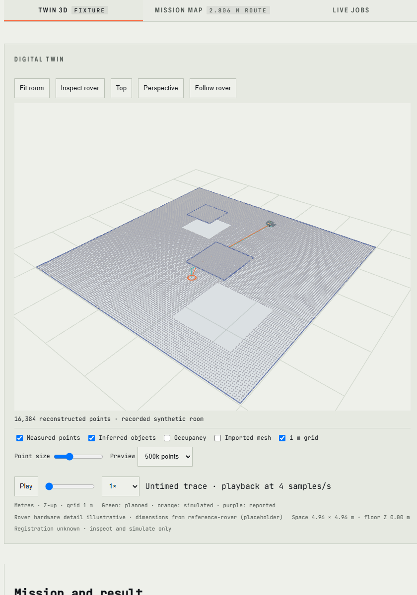

**One workspace for geometry and mission context.** The recorded fixture contains 16,384 reconstructed points from synthetic depth input. Camera controls, layer toggles, point size, scale and registration provenance remain visible. This is the current viewer, not the historical box-only screenshot.

### 02 / From a room-scale map to a rover-scale view

<table>
  <tr>
    <td width="50%">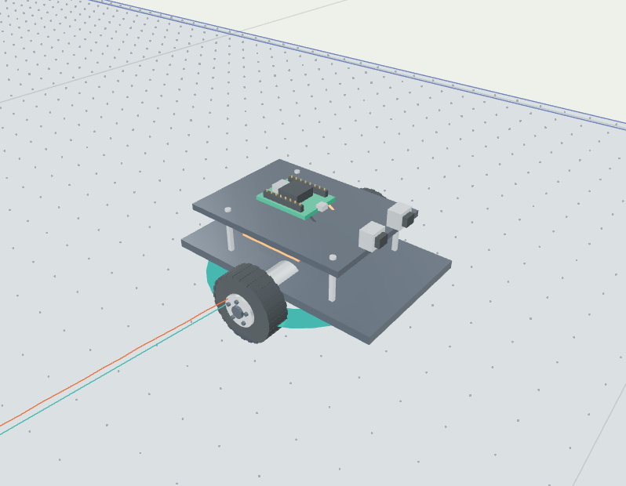</td>
    <td width="50%">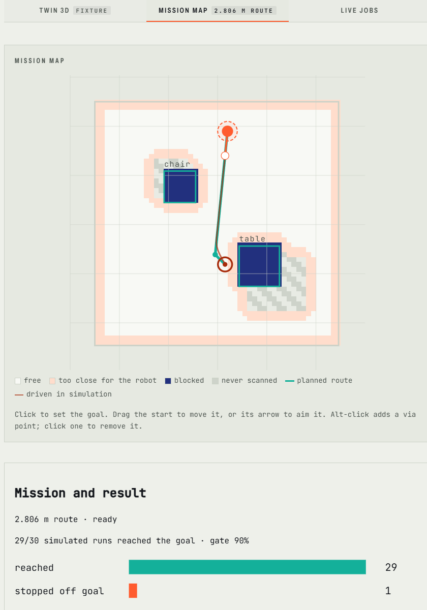</td>
  </tr>
  <tr>
    <td valign="top"><strong>Inspect rover</strong><br/>The real viewer's procedural model: chassis, wheels, hubs, electronics and forward sensor. Cosmetic details are illustrative; dimensions follow the selected specification.</td>
    <td valign="top"><strong>Inspect the mission</strong><br/>Free, blocked, unknown and clearance regions stay distinct. This recorded synthetic mission reports 29/30 simulated arrivals; it is not a physical-drive result.</td>
  </tr>
</table>

### 03 / Keep the workflow accessible on narrow screens

<table>
  <tr>
    <td width="34%">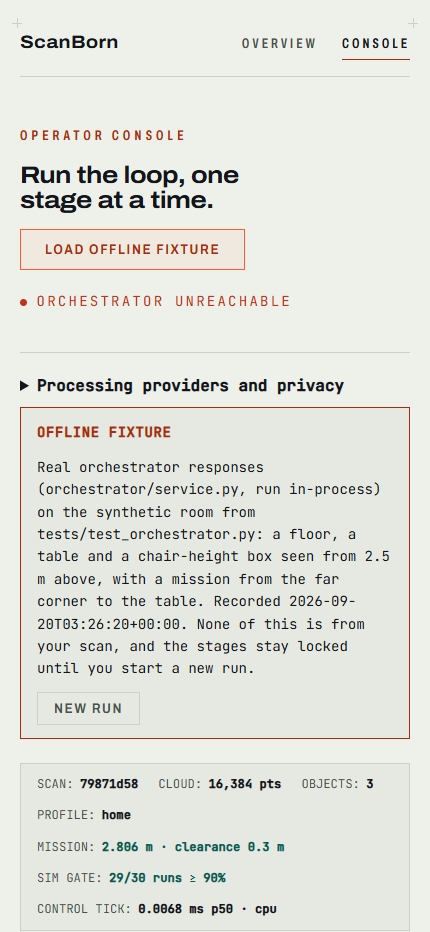</td>
    <td valign="top">
      <strong>Desktop workspace, responsive access</strong><br/><br/>
      Provider controls, scene provenance and pipeline status adapt to a narrow viewport. The screenshot shows the website at 430 CSS pixels, not the native Android app.<br/><br/>
      <strong>Native Android is a separate client</strong><br/><br/>
      Compose screens own capture, mission actions, networking and Stop/E-STOP. The same viewer is bundled inside Android, so scene coordinates and rover geometry are shared.<br/><br/>
      <a href="MOBILE-APP/README.md">Explore the Android project →</a>
    </td>
  </tr>
</table>

<details>
<summary><strong>Screenshot provenance and reproduction</strong></summary>

All images in this tour were captured from the current local Vite website on 22 September 2026 in a temporary Chrome profile. The console uses **Load offline fixture**, recorded from in-process orchestrator responses on synthetic geometry on 20 September. Its **Orchestrator unreachable** status is expected in this offline demonstration; no live service or physical robot is represented.

To explore the same views: run `npm run dev` in `dashboard/`, open `/dashboard`, select **Load offline fixture**, then use **Fit room**, **Inspect rover** and **Mission map**. The images are view captures, not new performance benchmarks or physical acceptance evidence. Sources and capture details are in [the visual asset notes](assets/readme/README.md).

</details>

## Why ScanBorn

Geometry, inferred labels, navigation decisions, controller results and reported motion remain separate so an operator can understand why a route was accepted, why a gate refused it or where a drive differed from simulation.

- **Room-specific operation:** robot footprint and clearance constrain the route.
- **Review before motion:** inspect geometry, unknown space, waypoints and validation before deployment.
- **Understandable controller:** linear behaviour cloning avoids a GPU training requirement for the current task.
- **Consistent visualization:** dashboard and Android share coordinates, layers and rover geometry.
- **Recovery without automatic driving:** reconnecting restores identities and status, never automatically restarts a drive.
- **Explicit uncertainty:** registration, placeholder dimensions, assumed noise and simulated calibration retain provenance.

### Intended use cases

| Use case | Workflow | Qualification |
|---|---|---|
| Robotics education | Inspect a room, plan a route, explain controller results | Synthetic/fake-rover workflow available |
| Indoor rover prototyping | Develop capture, planning, firmware and deployment together | Physical bring-up required |
| Scan inspection | Import PLY/OBJ; compare points, surfaces and navigation | Imports do not establish marker registration |
| Simulation research | Compare outcomes under slip, bias, latency and placement error | Assumed noise is not physical calibration |
| Recovery/safety engineering | Exercise interrupted requests, stale telemetry and sensor faults | Automated checks complement hardware tests |

## Architecture

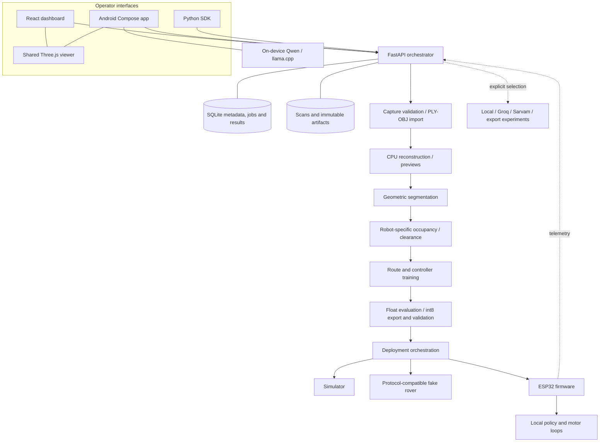

### Components and data ownership

| Component | Responsibility | Implementation |
|---|---|---|
| Orchestrator | APIs, deduplication, jobs, lineage, validation, robot reservation | [`orchestrator/`](orchestrator/) |
| Capture | Validation, stable IDs, atomic storage, imports and registration | [`capture/`](capture/), [Android capture](MOBILE-APP/app/src/main/java/com/scanborn/ai/scan/) |
| Reconstruction | Fusion, imported geometry, floor estimate, bounded previews | [`reconstruction/`](reconstruction/) |
| Semantics | Shape-based categories, separate from measurement | [`semantic/`](semantic/) |
| Twin | Occupancy, floor/obstacle interpretation, robot clearance | [`twin/`](twin/) |
| Planning/learning | Route search, demonstrator, linear cloning, noisy simulation | [`policy/`](policy/) |
| Export | Int8 bundle/manifest and optional experiments | [`deployment/`](deployment/) |
| Robot integration | Specs, protocol, adapters, calibration, accuracy reports | [`robot/`](robot/), [`firmware/`](firmware/) |
| Text intelligence | Local grammar, providers, contracts and execution limits | [`sarvam/task_engine/`](sarvam/task_engine/) |
| Interfaces | Dashboard, shared viewer, native controls and SDK | [`dashboard/`](dashboard/), [`MOBILE-APP/`](MOBILE-APP/), [`sdk/scanborn/`](sdk/scanborn/) |

SQLite owns metadata and identities; geometry/model outputs live in the artifact directory. Immutable output locations prevent later stages from overwriting files referenced by older missions. Lineage checks connect scan, mesh, semantic objects, twin, graph/mission, policy and artifact.

## End-to-end workflow

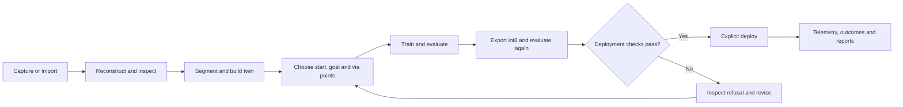

### 1. Capture or import

**Phone:** place the [home marker](docs/capture/home-marker.svg), align the phone with its arrow and capture ARCore depth with intrinsics, poses and optional colour. The marker defines the intended shared start frame; the procedure still needs physical phone acceptance.

Android saves admitted frames to an app-private queue before upload using a client-generated scan ID. Defaults cap admission at **300 pending frames and 64 MiB**. Finish stops admission before draining. Pending uploads survive screen/process loss; accepted, uploaded, pending, rejected and dropped counts remain distinct. Partial completion is explicit. Capture requests AI-model release first; phone model/ARCore handoff remains unverified.

**Import:** upload `.ply`/`.obj`; declare metres, centimetres, millimetres, feet or inches and Z-up/Y-up. Missing declarations are recorded as assumptions. Valid faces can be preserved as surfaces. Imports support inspection/simulation but do not prove home-marker registration for physical driving.

Validation checks depth/intrinsics/pose structure, dimensions, finite values, indices, upload limits and confined paths before atomic storage.

### 2. Reconstruct and inspect

Depth observations fuse into a canonical point cloud. Multi-view filtering rejects insufficient support where applicable; single-frame fixtures explicitly report reduced support. Original geometry stays separate from deterministic **100,000- and 500,000-point** previews.

A versioned manifest records asset references, bounds, floor, coordinates, capture/registration, semantics and spec provenance.

### 3. Build the twin

Geometric segmentation identifies a floor slab and shape-based clusters. Labels are inferred, not learned semantic ground truth or exact CAD reconstruction. The twin represents free, blocked and unknown cells at **5 cm or 10 cm**, selected from floor sampling density. Clearance follows the robot spec; never-observed floor is not silently considered safe.

### 4. Define the mission

Select start, goal and optional via points or enter coordinates. Route planning accounts for clearance and returns a path or concrete refusal. Text task planning is separate: targets must resolve against scene objects. Missing or ambiguous targets require clarification.

### 5. Train the controller

Global route planning and local control are separate. A geometric lookahead demonstrator supplies observations/actions:

```text
observation = [distance_to_lookahead × cos(heading_error), heading_error]
action      = W × observation + b
outputs     = [forward velocity in m/s, angular velocity in rad/s]
```

[`LinearPolicy`](policy/finetune/train_bc.py) fits demonstrations with ridge regression. The differential-drive controller has a 2 × 2 weight matrix and two biases. Speed/acceleration/turn limits belong to the rover model/runtime. This is compact behaviour cloning, not PPO or a learned world model.

The mission gate evaluates **30 noisy simulations**, requiring **90% success**: at least 27 arrivals within **0.10 m** of the true simulated goal. Outcomes distinguish reached, stopped off-goal, collided and timed out. The older missionless path retains a separate 60% random-start gate; see [`policy/evaluate.py`](policy/evaluate.py).

### 6. Export and validate

The local exporter writes `policy_int8.npz` with int8 weights/bias and per-tensor scales, plus a controller/spec manifest. Format is identified from bytes. The **exported int8 policy is evaluated**; a passing float checkpoint alone is insufficient. Stored validation binds checksum, robot-spec snapshot and gate result. Modified bytes, stale lineage or spec mismatch cause refusal.

### 7. Deploy and monitor

Choose simulator, fake rover or registered physical rover. The orchestrator reserves the robot, loads/starts the mission explicitly and handles heartbeat/telemetry. The rover tracks the path locally with encoder/gyro odometry.

Reference settings specify a **20 Hz policy loop**, **50 Hz motor PI loop**, **0.30 m/s speed cap** and **1-second missing-heartbeat E-STOP**. These are configured values, not measured physical performance. Stop/E-STOP remain outside the Android WebView and dashboard canvas. See the [protocol](docs/robot/rover-protocol.md).

Telemetry is validated before storage, rejecting stale/out-of-order updates. Compare reported poses, simulated traces and outcomes; timestamped traces support playback, while legacy untimed traces are labelled.

### 8. Calibrate, measure and revise

Calibration is a separate bring-up/measurement loop: processing a scan does not calibrate a robot. Asynchronous straight, spin and bounded wheel-step sessions keep Stop/E-STOP, telemetry, heartbeat and sensor checks active. Measured travel derives encoder distance scale; rotation derives effective wheelbase. These experiments do not calibrate unrelated noise parameters.

Configuration application retains prior settings, verifies read-back and records reconciliation failures. Fake results remain simulated. Sign checks, square odometry and tape-measured goal-error trials are covered by [accuracy measurements](docs/robot/accuracy-measurements.md). Registered rescans can invalidate unsafe routes; same-marker confirmation is explicit.

## The shared 3D workspace

[`dashboard/shared-viewer/`](dashboard/shared-viewer/) separates scene, geometry, camera, rover, layers, picking, playback and lifecycle. React/Compose own mission actions; the viewer renders and returns selection events.

| Layer / interaction | Meaning |
|---|---|
| RGB points | Actual reconstruction samples; circular depth-tested points, adjustable size |
| Imported surface | Preserved PLY/OBJ faces, separate from navigation |
| Semantic boxes | Inferred extents/categories |
| Occupancy/clearance | Navigation interpretation of measured/unknown space |
| Reference rover | Motion-related scale from spec; cosmetic parts illustrative |
| Routes/markers | Home/start/goal/via and planned path |
| Traces/playback | Simulated/reported motion; pause, scrub, speed |
| Camera modes | Fit room, inspect rover, top, perspective, follow |

The common transform is **map `(x, y, z)` → render `(x, z − floor_z, −y)`**, with metres and right-handed Z-up on the map. Geometry, picking, routes and telemetry share it, including nonzero floor height.

The rover includes chassis plates, wheels/hubs, motors, caster, battery, controller and forward sensor. Materials, environment/key lighting and contact shadows provide depth without bloom/SSAO. Material batching reduces draw submission; bounded trace buffers avoid unbounded geometry reconstruction. Camera state survives telemetry updates, and hidden/idle scenes avoid unnecessary rendering.

Android bundles assets with `WebViewAssetLoader`, restricts message origins/navigation and caches the last inspected scene with its timestamp. Networking/status/stop controls remain native. Resource disposal and failure handling have laptop/emulator checks; full phone GPU acceptance remains open.

<details>
<summary><strong>Historical console screenshots — synthetic fixture</strong></summary>

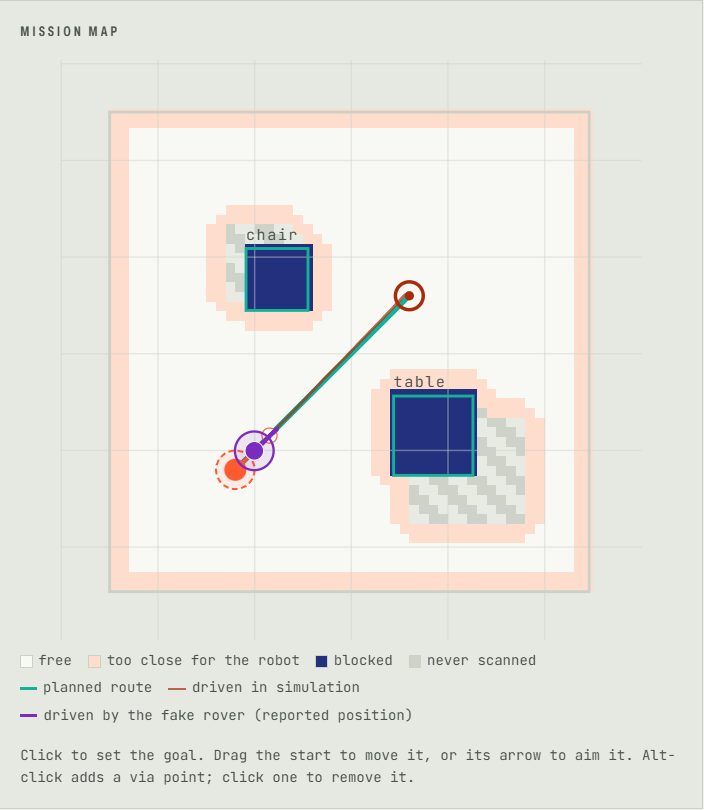

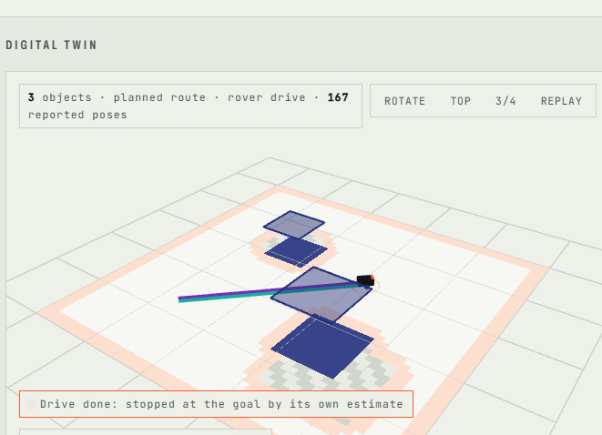

Retained screenshots show an earlier console and fake rover. The 3D image predates the current point-cloud/shared-viewer presentation; it is not a phone scan or current visual acceptance capture.

</details>

### Reference rover / software model and hardware target


The rover above is rendered by [`buildRover`](dashboard/shared-viewer/rover.js), the same module used by dashboard and Android. It is a procedural engineering illustration, not a photograph of an assembled robot or a fabrication-ready CAD model.

| Visible assembly | Intended role | Source of truth |
|---|---|---|
| Chassis plates and supports | Carry the electronics and drivetrain | Procedural geometry; cosmetic dimensions illustrative |
| Two driven wheels and hubs | Differential-drive motion | Wheel radius and wheelbase from the robot spec |
| Motors and caster | Drive and passive support | Reference hardware illustration |
| Controller board and battery | Embedded control and power | Illustrative arrangement, not a wiring diagram |
| Forward sensor | Reference front-ranging hardware | Planned VL53L0X; firmware readiness/safety logic is separate |

The checked-in [reference specification](robot/specs/rover.yaml) currently uses a **65 mm wheel diameter**, **170 mm wheelbase**, **150 mm footprint radius** and **120 mm height**. These are placeholder configuration values, not tape-measured hardware dimensions. Inspecting the rover changes the camera distance; it does not enlarge the rover within the room.

## Reliability and recovery

| Failure / inconsistency | Response |
|---|---|
| First capture response lost | Retry retains client-generated scan ID |
| Slow/offline upload or exit | Bounded disk queue; explicit retry/partial completion |
| Processing response lost | Persistent lookup; Android journals ID, inputs and checkpoint |
| App process dies | Restore identities; no automatic stage POST or drive restart |
| Failed/interrupted stage | Visible terminal state; native acknowledgement before new work |
| Replaced geometry/training | Invalidate downstream mission/policy/artifact selections as appropriate |
| Server restart | Unfinished jobs become interrupted, not replayed |
| Duplicate deployment | Stable request ID and atomic robot reservation |
| Stale mission/spec or altered artifact | Lineage/checksum/validation refusal |
| Heartbeat/sensor fault | Firmware stop/latch according to protocol |
| Renderer failure | Native status/stop remain operational |

The native journal covers reconstruction, segmentation, twin generation, training and optimization. Lookup is read-only; retry is explicit with original inputs/identity. Full dashboard-wide stage recovery and every navigation/lifecycle combination are not claimed complete.

## Local processing and optional APIs

| Workload | Default | Optional path | Boundary |
|---|---|---|---|
| Text planning | Local grammar | Groq / Sarvam | Instruction + labels; common target/action contract |
| Environment profiling | Local inference | Groq | Scene summary; validated result |
| Deployable export | Local NPZ int8 | Always retained | Only supported deployment format |
| Export experiments | Disabled | AI Hub / local QAIRT converter | TFLite/DLC outputs not deployable here |
| Phone assistant | Qwen GGUF / llama.cpp | Separate from server settings | Phone CPU; not rover controller |

Select ordered chains such as `groq,local` in dashboard/Android controls. Saved settings override environment defaults for subsequent work. Remote choices require explicit outgoing-data consent in that settings flow; credentials stay server-side. A key alone does not enable a provider.

Execution bounds deadlines, response sizes, concurrency and daily remote-request counts, with selective retries and recorded fallback reasons. Request ceilings do not estimate currency cost. Live-provider quality, cost and latency are unbenchmarked. See [configuration](.env.example), [providers](orchestrator/providers.py) and [contracts](sarvam/task_engine/contract.py).

## Benchmarks and performance

**Recorded measurements, calculated sizes and acceptance targets are separated below.** No competitor benchmark or measured real-rover accuracy is claimed.

### Shared renderer: laptop

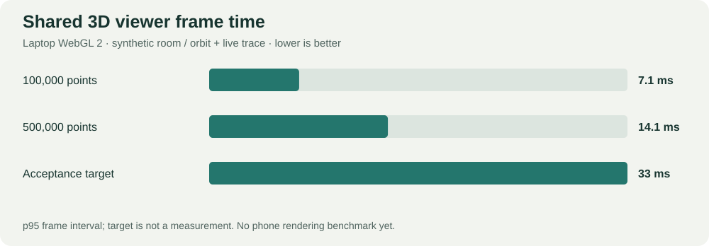

| Scenario | p50 | p95 | Conditions |
|---|---:|---:|---|
| 100,000 points | 6.9 ms | 7.1 ms | 707 × 384 CSS pixels |
| 500,000 points | 13.8 ms | 14.1 ms | 707 × 384 CSS pixels |
| 500,000 points, rover batched by material | 13.9 ms | 14.1 ms | 1240 × 396; 20 draw calls, 14 geometries, 4 textures |
| Acceptance target | — | ≤33 ms | Laptop 500k / S24 FE 100k; phone unmeasured |

Source: [`benchmarks/renderer.json`](benchmarks/renderer.json), 17 September. Synthetic 8 × 6 × 2.8 m room, floor Z = 2 m; 45 warm-up frames then 360-frame orbit/growing trace; ANGLE Intel UHD / Direct3D11 / WebGL 2, pixel ratio 1.25. Frame intervals are not GPU timer measurements. Eight 100k-point mount/disposal cycles removed canvases/released contexts with stable counters; this is not a full heap profile. An earlier ~1007 ms anomaly was not reproduced; its cause remains unresolved in the record.

### Route planning: resolution and caching

| Grid | Cells | Navmesh build | Cold plan p50 / p95 | Cached-clearance p50 / p95 |
|---|---:|---:|---:|---:|
| 10 cm | 120 × 100 | 64.3 ms | 3.7 / 10.8 ms | 2.7 / 8.3 ms |
| 5 cm | 240 × 200 | 60.5 ms | 15.3 / 36.7 ms | 11.4 / 30.9 ms |

Source: [`benchmarks/planning.json`](benchmarks/planning.json), 14 September. Synthetic 12 × 10 m room, 698,314 points, eight furniture objects, 20 missions; i5-13450HX, Python 3.11.9. Both resolutions met the recorded **250 ms p95 budget**. Finer cells increase search cost; this does not establish performance on real phone scans.

### Phone model: speed versus memory

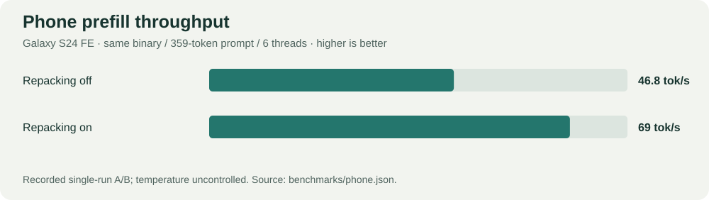

| Same-binary A/B, six threads | Repacking off | Repacking on |
|---|---:|---:|
| Prefill | 46.8 tok/s | 69.0 tok/s |
| First token | 7.695 s | 5.308 s |
| Total for 256 generated tokens | 25.749 s | 18.955 s |
| App-owned RSS after reply | 284,144 KiB | 1,200,772 KiB |

Source: [`benchmarks/phone.json`](benchmarks/phone.json), 14 September. Galaxy S24 FE / Exynos 2400e / Android 16, Qwen2.5-1.5B-Instruct Q4_K_M, identical 359-token prompt. Repacking delivered approximately **47% higher prefill**, **31% sooner first token** and **26% shorter total response** in these single runs, while increasing app-owned memory. Temperature was uncontrolled; decode variability prevents a strong decode-speed conclusion. The baseline build used a different prompt and is excluded from this A/B chart.

These are language-model timings—not scan processing, rover inference or NPU performance. The model file is **1,117,320,736 bytes**; no matched unquantized measurement establishes a GGUF compression ratio.

### Compression and bounded geometry

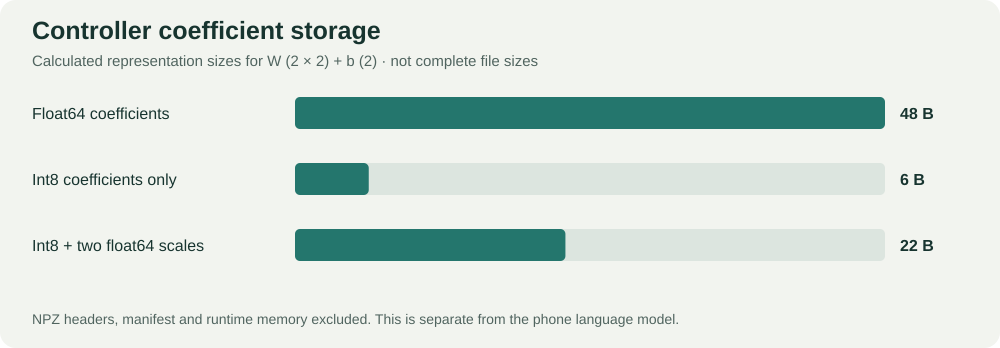

The controller has six coefficients. [`LinearPolicy`](policy/finetune/train_bc.py) stores float64 values; export stores int8 arrays and two scales:

| Representation | Calculation | Numeric payload |
|---|---|---:|
| Float64 weights/bias | 6 × 8 bytes | 48 bytes |
| Int8 weights/bias only | 6 × 1 byte | 6 bytes |
| Int8 plus two float64 scales | 6 + 2 × 8 bytes | 22 bytes |

**Calculated, not a file-size benchmark:** coefficients alone shrink 8×; including scales reduces numeric payload by about 54%. NPZ headers, manifest, protocol encoding and runtime memory are excluded. The complete bundle is not 8× smaller by implication; NumPy evaluation can dequantize values. Quantization does not establish accelerator execution or latency speedup.

Geometry uses **16 bytes per preview point**: float32 XYZ, sRGB RGB bytes and padding. Full 100k/500k levels contain **1.6 MB / 8.0 MB** of records (decimal MB, excluding transport/manifest). This is bounded deterministic sampling, not lossless compression; the original is unchanged. Sparse scenes emit fewer points. Source: [`reconstruction/visualization.py`](reconstruction/visualization.py).

### Accuracy: evaluated versus unmeasured

| Evaluation | Recorded result | Interpretation |
|---|---|---|
| Local intent set v1 | 38 cases: 16 successes, 18 correct refusals, 1 differently classified refusal, 3 abstentions; 0 wrong/unsafe plans | Small frozen set, not general-language accuracy |
| Release controller suite | 600/600 simulated runs passed, zero collisions | Three traversable scenes × 100 reserved seeds × float/int8 |
| Int8 p95 goal miss | Straight 3.368 cm; corner 4.562 cm; detour 6.249 cm | Simulated truth under assumed robot/noise parameters |
| Physical goal error | Not measured | Registered capture, calibrated rover and tape measurements needed |

Sources: [intent report](benchmarks/intents-local-v1.json) and [release evidence ledger](docs/superpowers/plans/2026-09-18-execution-plan.md). Release evaluation includes blocked-goal/unknown-barrier refusal cases and retains suite hash, seeds, policy/artifact checksums, spec snapshot and per-run outcomes. The reference policy was trained separately; release scenes/seeds must remain reserved from tuning. This recorded result does not guarantee future policies. Hindi inputs in the local evaluation abstain; remote planners have not been scored.

### Architectural comparisons

| Choice | Advantage | Trade-off |
|---|---|---|
| Local + optional APIs | No mandatory service dependency; optional text/profile extensions | Local language limits; API privacy/cost/availability considerations |
| Linear cloning | Inspectable policy, CPU training, straightforward export | Expressiveness follows engineered observations/demonstrator |
| Points + navigation grid | Measured samples and explicit unknown space | No TSDF or survey-grade surface claim |
| Shared viewer | Common coordinates/layers/rover across clients | WebView/GPU lifecycle needs device testing |
| Dead reckoning | Local encoder/gyro control after marker placement | Drift; no continuous global position correction |

These are design trade-offs, not measured comparisons against commercial products.

## Technology stack and hardware

| Layer | Technologies |
|---|---|
| API/persistence | Python 3.10+, FastAPI, Uvicorn, SQLite, Pydantic |
| Geometry/learning | NumPy, SciPy, CPU fusion/segmentation, grid planning, ridge regression |
| Dashboard/3D | React 18, Vite 8, Three.js, GSAP landing animation, SVG charts |
| Android | Kotlin, Compose, lifecycle/SavedStateHandle, Room, ARCore, WebViewAssetLoader |
| On-device AI | llama.cpp, JNI/C++, Qwen2.5-1.5B-Instruct Q4_K_M GGUF, ARM kernels/repacking |
| Embedded | ESP32 Arduino firmware, encoder/gyro/ToF, local policy and motor PI loops |
| Verification | pytest, flake8, mypy, Vitest, Android JVM/instrumentation, browser tests, firmware host/QEMU |
| Packaging | Python SDK, npm/Vite, Gradle/CMake/NDK, optional Docker image |

Project hardware: **i5-13450HX Lenovo LOQ**, **Galaxy S24 FE / Exynos 2400e / 8 GB class**, and a reference ESP32 rover targeting two JGB37-520 encoder motors, MPU6050 and VL53L0X. The [rover spec](robot/specs/rover.yaml) labels dimensions as placeholders and noise as assumed; consult the [hardware plan](docs/superpowers/plans/2026-09-14-phase-4-rover-protocol.md).

There is no active PPO, Unity ML-Agents, Whisper or NPU path in the current local robotics pipeline. AI Hub/QAIRT are experiments, not an Exynos accelerator backend.

## Quick start

### Requirements

- Python 3.10+; Node.js 20.19+ or 22.12+ for the dashboard toolchain.
- Laptop/desktop CPU for processing; WebGL-capable browser for interactive 3D.
- Android build: JDK 17, SDK 36, NDK 28.2.13676358, CMake 3.22.1. App targets ARM64, minSdk 24; capture needs compatible ARCore depth hardware.
- Credentials only for deliberately selected providers. CI compilation needs no model weights; phone inference needs the supplied GGUF.

### 1. Orchestrator

From the checkout root:

```bash
python -m pip install -e . -r requirements-dev.txt
python -m uvicorn orchestrator.service:app --port 8000
```

Open `http://localhost:8000/docs`. Default storage: `data/scanborn.db` and artifacts in `data/`. Set `SCANBORN_DB` and `SCANBORN_DATA` to isolate experiments.

For phone/rover access, add `--host 0.0.0.0`, use the computer's LAN address and allow HTTP 8000 / telemetry UDP 5005 through the local firewall. **Use a trusted private network:** the rover protocol has no authentication. Session IDs prevent stale-session confusion, not unauthorized access. Public hosting requires additional security work.

### 2. Dashboard

In another terminal:

```bash
cd dashboard
npm ci
npm run dev
```

Open the displayed Vite URL: `/` is the illustrative landing page, `/dashboard` the console. Vite proxies API calls to `http://localhost:8000`; `ORCHESTRATOR_URL` changes it. The landing animation is procedural presentation content, not scan data.

Import PLY/OBJ or choose **Load offline fixture** to inspect a recorded run without a server. From the repository root, `python scripts/seed_synthetic_scans.py` supplies synthetic input to a running orchestrator.

### 3. SDK

```python
from scanborn import ScanBorn
from tests.test_orchestrator import scan_frame  # repository-only synthetic example

with ScanBorn("http://localhost:8000") as client:
    result = client.run_pipeline(
        [scan_frame()], text="go to the table",
        start=(-1.2, -1.2), goal=(0.6, 0.6),
    )
    print(result["sim_success_rate"], result["deployment_id"])
```

For exported geometry, `client.import_scan("room.ply", units="cm", up_axis="y")` supplies declarations; invoke subsequent stages individually. The example defaults to simulated deployment, not a physical rover. Inspect gate refusals rather than bypassing them.

### 4. Android and firmware

**The mobile project is [`MOBILE-APP/`](MOBILE-APP/)**; sources are in [`app/src/main/`](MOBILE-APP/app/src/main/).

```powershell
cd MOBILE-APP
.\gradlew.bat :app:testDebugUnitTest :app:assembleDebug :app:assembleDebugAndroidTest
```

Use `./gradlew` on POSIX. The [mobile README](MOBILE-APP/README.md) covers model provisioning and saving/testing the server address. Spaces provides scans/twins, missions, providers, history and recovery.

From the repository root:

```bash
python -m nox -s firmware_host firmware_calibration_host firmware_safety_host
python -m nox -s firmware
python -m nox -s firmware_qemu
```

Compiler, ESP32 toolchain, ArduinoJson and QEMU prerequisites are in [`noxfile.py`](noxfile.py). These are build/test commands, not instructions to energize motors.

<details>
<summary><strong>Optional providers and containers</strong></summary>

Start with [`.env.example`](.env.example):

```text
SCANBORN_PLANNER=local
SCANBORN_PROFILER=local
SCANBORN_EXPORT=local
```

Choose providers through dashboard/Android or server environment settings. `groq,local` permits recorded fallback. Keys alone do not enable remote work. AI Hub/QAIRT need additional dependencies from `requirements-npu.txt`; outputs remain non-deployable experiments.

Docker packaging: `docker compose -f docker/docker-compose.yml up --build`. Container runtime verification remains open; a Dockerfile is not proof of a successfully running image.

</details>

## Public interfaces

| Area | Representative routes |
|---|---|
| Capture/import | `POST /capture`, `POST /capture/import`, `GET /capture/{scan_id}` |
| Processing | `POST /reconstruct`, `/segment`, `/generate-twin`, `/train`, `/optimize` |
| Visualization | `GET /meshes/{id}/visualization`, `/twins/{id}/visualization`, ID-scoped assets |
| Missions | `POST /missions`, `GET /missions/{id}`, text planning through `/plan` |
| Discovery | Paginated `/scans`, `/twins`, `/robots`, `/missions`, `/deployments` |
| Recovery | `GET /stages/{stage}/requests/{request_id}`, `/deploy/requests/{request_id}` |
| Providers | `GET /providers`, `POST /providers/settings` |
| Robot sessions | `/deploy`, deployment status/stop, robot status/E-STOP, calibration routes |
| Rescans | `POST /sync` with explicit registration confirmation |

The [OpenAPI contract](docs/api/openapi.yaml) is authoritative for schemas/parameters. Existing stage routes and SDK behavior are retained as recovery, provenance and visualization fields are added.

## Verification

Latest recorded full regression: **20 September 2026**, not a fresh run caused by this documentation update.

| Check | Recorded evidence |
|---|---|
| Python | **675 passed, 1 skipped**, 362.08 s |
| Canonical lint/types | flake8 passes; mypy clean across **132 source files** |
| Dashboard | **83 Vitest tests** and production build |
| Android | **50 JVM tests**; debug/instrumentation APK builds |
| Ordinary emulator instrumentation | **9 passed, 2 harness-only methods skipped** |
| Separate process-kill harness | **4 pass:** deployment, calibration, stage, synthetic capture queue |
| Browser | **18 recorded isolated checks**, including geometry/context-loss/recovery and narrow-screen controls |
| Firmware | **49 calibration host checks**, **23 sensor-safety checks**, math/golden, ESP32 compile and QEMU |
| Source completeness | **139 application files**, none ignored |

Conditions and local evidence paths are in the [execution ledger](docs/superpowers/plans/2026-09-18-execution-plan.md). Emulator/synthetic checks do not close physical acceptance. Process tests verify new PID, original request/frame identity, no automatic motion replay and final APK checksum consistency.

From the repository root:

```bash
python -m pytest -q
python -m nox -s lint
python scripts/check_source_completeness.py
python scripts/check_live_drive.py
python scripts/check_android_process_recovery.py --serial emulator-5580 --out build/process-recovery
```

Browser checks need documented running services/browser prerequisites. The process harness requires matching APKs and a booted emulator; it force-stops the test app and refuses physical-device serials.

From `dashboard/`:

```bash
npm test
npm run build
npm run build:viewer
```

Reserved release evaluation, with actual artifact paths:

```bash
python scripts/evaluate_release.py --policy PATH --artifact PATH --spec rover --out NEW_REPORT.json
```

[GitHub Actions](.github/workflows/ci.yml) defines Python 3.10–3.12 tests/lint, Bandit, dashboard/shared-viewer packaging, Android compilation without model weights and firmware host checks. Configured CI is distinct from proof of a completed hosted run.

## Limitations and future scope

| Open area | Next evidence / work |
|---|---|
| Phone capture | Room scan, marker/two-metre axis walk, tracking interruption, permissions, model release/reload |
| Physical rover | Board bring-up, motor/encoder/gyro signs, calibration, read-back and tape-measured errors |
| Mobile lifecycle/3D | Full navigation, real WebView/GPU lifecycle, S24 FE 100k-point p95 ≤33 ms and resource checks |
| Live APIs | Reserved-set accuracy with model identity, latency and failure records |
| Recovery completion | Broader navigation/reconciliation cases and dashboard-wide stage recovery |
| Geometry/semantics | Real-room validation; labels remain heuristic and grid navigation is not full 3D traversability |
| Localization | Quantify drift; no continuous global correction after marker placement |
| Packaging/security | Container runtime verification, mobile packaging/branding cleanup and protection beyond trusted LAN |

The current iteration preserves the CPU pipeline and phone model. TSDF reconstruction, learned semantic labels, new model downloads, phone-mounted localization, voice-triggered missions and cinematic presentation are outside its agreed scope. They are possible later directions, not implemented capabilities.

Use the [enhanced master plan](docs/superpowers/plans/2026-09-18-enhanced-master-plan.md) for architecture/accuracy targets and [execution plan](docs/superpowers/plans/2026-09-18-execution-plan.md) for status/evidence. **The full plan is not complete.**

## Documentation map

| Topic | Reference |
|---|---|
| Current orientation | [START-HERE](docs/superpowers/START-HERE.md) |
| Architecture/acceptance | [Enhanced master plan](docs/superpowers/plans/2026-09-18-enhanced-master-plan.md) |
| Implementation evidence | [Execution ledger](docs/superpowers/plans/2026-09-18-execution-plan.md) |
| API/database | [OpenAPI](docs/api/openapi.yaml), [database](docs/api/database.md) |
| Android build/model | [Mobile README](MOBILE-APP/README.md) |
| Rover/calibration | [Protocol](docs/robot/rover-protocol.md), [accuracy measurements](docs/robot/accuracy-measurements.md) |
| Spec provenance | [Specification revisions](docs/robot/specification-revisions.md) |
| Raw benchmarks | [Phone](benchmarks/phone.json), [planning](benchmarks/planning.json), [renderer](benchmarks/renderer.json), [intents](benchmarks/intents-local-v1.json) |
| Security/dependencies | [Security policy](SECURITY.md), [third-party licenses](docs/THIRD_PARTY_LICENSES.md) |

## History, team and license

ScanBorn began with a Snapdragon/Unity/Arduino UNO Q/Hexagon-NPU hackathon architecture. [`experiments/rc_buggy_snapdragon/`](experiments/rc_buggy_snapdragon/) and [`detailed implementation doc.md`](detailed%20implementation%20doc.md) retain that earlier direction. The current system uses the Exynos phone, CPU pipeline and ESP32 target.

| Contributor | Role |
|---|---|
| Aditya Pandey | AI, edge AI and embedded systems |
| Adhishvar Singh | Robotics and autonomous systems |
| Palak Rai | Full-stack and cloud infrastructure |

Contact: **aditya060806@gmail.com**. Licensed under [MIT](LICENSE); see [third-party licenses](docs/THIRD_PARTY_LICENSES.md).

```bibtex
@software{ScanBorn2026,
  title={ScanBorn: From a Phone Scan to a Simulation-Gated Robot Controller},
  author={Team Ghost Map},
  year={2026},
  url={https://github.com/Aditya060806/ScanBorn}
}
```
