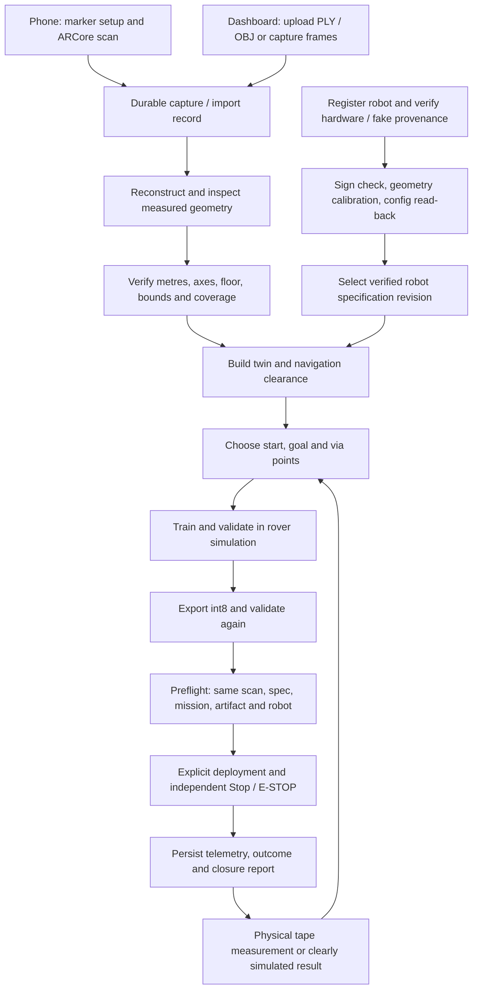

# ScanBorn: completion plan from phone scan to physical drive

Historical plan: consolidated into the [enhanced master plan](2026-09-18-enhanced-master-plan.md)
and [execution checklist](2026-09-18-execution-plan.md). Follow that pair for current work.

Provider architecture amendment (18 September): read
[Local-first, cloud-capable](2026-09-18-local-first-cloud-capable.md) alongside this plan.
It adds explicit API secondary providers, bounded fallback and truthful export provenance;
the scan-to-drive and physical acceptance gates below remain required.

## Purpose and baseline

The intended product is a guided workflow: scan a room on the phone **or import a scan on the
dashboard**, inspect the measured reconstruction, prepare the robot and its coordinate frame,
build a navigable twin, choose a mission, validate a controller in software, deploy explicitly,
and compare the reported result with physical measurements.

That architecture is substantially implemented, but it is not yet a physically demonstrated,
fully recovered end-to-end product. This plan supersedes earlier remaining-work lists where it
identifies a more specific dependency or defect. Implementation changes are not part of this
planning pass. Preserve current uncommitted work; no commits, pushes, new models or downloads.

Sources reviewed:

- Supplied `Scanborn.pptx`: nine slides, including the original workflow and hardware claims.
- Supplied `ScanBorn_Overview.pdf`: 24 pages, including its two architecture sketches.
- Supplied G-one README: a separate health project; useful as a reference for explicit pipeline
  ordering, deterministic checks, durable records, failure isolation and honest verification.
  Its health features, dependencies, test counts and instructions do not become ScanBorn requirements.
- ScanBorn root README, approved reliability/shared-viewer plan, current audit/handoff, and
  relevant Android, viewer, orchestration, calibration, spec and firmware implementations.

### Resolve the old-document discrepancies

| Old slides / overview | Current baseline for this iteration |
|---|---|
| Snapdragon / Hexagon NPU / Arduino UNO Q | Galaxy S24 FE (Exynos), laptop CPU pipeline, ESP32 rover |
| Unity, PPO, NeRF / Gaussian splatting | CPU depth fusion or imported geometry, occupancy navigation, behaviour-cloned route controller |
| Automatic marker localisation on phone and robot | Operator establishes the marker frame and start pose; no continuous visual localisation |
| Voice chooses activities/models and deploys | Numeric/map-selected navigation mission; chat/voice are separate capabilities; voice-triggered missions remain outside this iteration |
| Generic pick/follow/manipulation activities | Differential-drive navigation to a goal through optional via points; no manipulator implementation |
| Network loss does not stop the robot | Policy runs locally, but heartbeat loss deliberately stops/latches the rover. No internet requirement does not mean no local communication requirement. |
| NPU latency, power and acceleration ratios | Historical targets, not current ESP32 or S24 FE measurements |
| 60% / 20 evaluation runs | Legacy non-mission gate; mission workflow uses at least 27/30 successful simulated runs and revalidates the exported int8 policy |

Do not reintroduce the old stack merely to match the pitch. Rewrite public descriptions after
verification so supported behaviour, future ideas and historical claims are clearly separated.

## The operator workflow

Calibration is not reconstruction. Scan registration establishes metres, origin, axes and initial
heading. Robot calibration measures encoder travel and effective wheelbase. They can be performed
independently, but the accepted spec must be selected before final training/export. A changed wheel
calibration requires retraining and re-export; changed footprint/clearance also requires rebuilding
the twin and replanning. Noise remains assumed until separately measured.

Phone capture and dashboard import converge on the same server pipeline. Upload means supplying
actual supported geometry/depth data; ordinary photographs or arbitrary video do not become a
reconstruction through the current importer. An imported file with unknown scale or alignment must
not imply that the physical rover is registered to it.

The app and dashboard supervise. The laptop reconstructs, plans and trains. The ESP32 executes
the validated controller, samples its sensors and enforces its stop/deadman limits. The language
model is not a motion-authorisation or safety dependency.

## Current evidence and limits

| Area | Present evidence | Still required |
|---|---|---|
| Source / foundation | 118 Android source files present, none ignored; Library/prompt/storage fixes; builds pass | Actual phone upgrade/Library/About checks; include new sources when a commit is requested |
| Scan / import | Stable IDs, bounded disk queue, server validation, atomic storage; synthetic/generated input tests | Real phone scan, interrupted tracking, process-kill and slow/offline-network proof |
| Pipeline | Immutable outputs, lineage and int8 checks, persistent jobs, deployment deduplication | Calibration-to-spec integration and complete client recovery after unknown outcomes |
| 3D | Real RGB preview, imported surface support on dashboard, floor transform, true-scale detailed rover, context recovery | Native surface/control parity, scene identity restoration and device performance |
| Laptop rendering | Recorded 500k orbit/live trace: 14.1 ms p95; eight clean mount/dispose cycles | S24 FE 100k <=33 ms; GPU counters are not a whole-process heap proof |
| Dashboard | Fake mission/training/export/drive, Stop/E-STOP, reload recovery, square report | Saved-session discovery, non-deploy recovery, full narrow-screen regression |
| Android | Native mission actions, stop controls, cache, pagination, playback feedback and calibration UI compile | Physical registration form, full lifecycle/unknown-response recovery and result parity |
| Calibration | Fake experiments, math, read-back/rollback, simulated separation; dashboard reload/Stop checked | Current spec identity/path defects, firmware fault tests and measured hardware calibration |
| Regression | Last full Python run 445 passed; later focused checks; latest 59 dashboard tests and Android builds pass | Final full-tree regression, device instrumentation and clean CI |

No new runtime acceptance tests were performed for this document. These are prior measured checks
and a fresh code/document inspection, not a new claim of end-to-end success.

## Ordered implementation packages

### P0 — Close robot specification and calibration identity

Why first: the current calibration screen can succeed without supplying the geometry that the
next training run uses. Fix this before further hardware-oriented UI work.

Confirmed code seams:

- `robot/specs/rover.yaml` has internal name `reference-rover`; `load_spec` resolves a filename.
  Physical calibration apply calls `load_spec(snapshot["name"])` and writes that name as a file.
  This can fail or target a different file from the default `rover.yaml` used for training.
- Fake apply writes `data/simulated-specs/<robot_id>.yaml`; normal training uses `load_spec` from
  `robot/specs`. There is no normal client path that binds that fake calibration revision to training.
- Visualization currently loads the default rover spec rather than a historical pipeline-bound
  spec, so displayed dimensions/provenance can drift from an earlier validated run.

Work:

1. Separate stable spec identifier, display name, robot identity and immutable revision/checksum.
   Resolve files internally; clients select IDs, never arbitrary paths. Migrate existing references
   additively and preserve the default spec alias.
2. Bind calibration sessions to that spec revision and physical/fake robot identity. Apply stores
   previous/proposed/read-back state; retries and crashes reconcile rather than claim success.
3. Make twin metadata, train, export, preflight and viewer use the selected snapshot consistently.
   Keep fake revisions isolated; never let simulated measurements update a physical spec.
4. Invalidate downstream selections visibly when geometry/clearance changes. Preserve historical
   artifacts and results. Keep noise provenance independent of calibrated wheel geometry.

Exit proof: nontrivial fake calibration -> train with updated revision -> exported-int8 gate ->
deploy succeeds; old revision refuses. Alias/name mismatch, changed config, bad read-back,
local-write failure and process interruption have regression tests. Physical-spec bytes remain
unchanged by every fake experiment. API, SDK, Android models and OpenAPI change together.

### P1 — Make both scan entrances recoverable and physically interpretable

Work: complete queue fault tests and deterministic acknowledgement accounting; retain capture
identity after first-response loss and process recreation; recover pending frames without a new
scan; serialize Finish/Cancel; require explicit partial completion. Display coverage/tracking and
uploaded/pending/rejected/dropped counts. Bound reads before allocation as well as before commit.

Add/review imported scale, up-axis and registration metadata and their confirmation UI. Preserve
original geometry, show actual bounds/floor, and refuse unsupported/corrupt/oversized input without
leaving a usable-looking half-import. A scan ready to inspect is distinct from a scan ready to drive.

Exit proof: phone and dashboard samples produce the same canonical axis/scale fixture; known
nonzero floor and imported faces remain correct; offline/slow/drop/restart/Finish-Cancel cases lose
no acknowledged frames or identities. Physical two-metre axis walk remains in P7.

### P2 — Finish Android mission, registration and recovery

Confirmed gaps: only fake registration is offered in `SpacesScreen`; selecting a robot does not
reconcile its calibration history; calibration identity is saved only after a successful POST
response. Refresh enables connectivity and reloads mission metadata, but does not fully revalidate
cached scene/twin/scan/spec lineage and restore the mission path into the scene.

Work:

- Add physical rover address/name registration with capability, firmware and current config status.
- Persist request identity before mutation; recover unknown deployment/calibration outcomes with
  read-only lookup. Restore the same robot/session; never auto-start a drive after restart.
- Start safety watchers independently of discovery/health loading; keep reconciling state distinct
  from online/ready. A reachable health endpoint alone must not enable mission mutations.
- Bind scene, mission, selected robot and calibration display explicitly. Prevent old robot A's
  results/actions being presented as robot B's. Confirm selected twin's scan and reload its path.
- Persist/restore the active identities across rotation, process death and server changes. Keep
  native Stop/E-STOP operational during training, reconnects and renderer failure.

Exit proof: instrumented rotation/process restoration, stopped backend, lost POST responses,
robot switching, stale mission and renderer crash tests; one physical-registration UI path and
one fake drive path use the same native controls. No competing mutation is enabled while outcome
or ownership is unknown.

### P3 — Finish viewer and result parity

Work: native imported-surface loading/cache, Perspective/point-size controls, useful object
selection/dimensions and complete layer legend; offline timestamp/identity; retry and 2D fallback
after WebView failure. Bound cache downloads before allocation and retain a usable prior cache if
replacement fails. Verify playback progress/completion feedback, untimed old traces and live pose
updates without camera resets. Spec rendering follows P0; decorative parts stay illustrative.

Add native square report and a persistent trial record containing deployment/mission/spec IDs,
reported closure, externally entered tape offsets, units, timestamp and simulated/measured
provenance. Incomplete/stopped runs say so. Do not invent final orientation correction or align
untimed traces as if they had recorded timestamps.

Exit proof: same fixture, selected coordinates and route in both clients; missing colors,
large/sparse scans, nonzero floor, context loss, repeated scene changes and camera preservation;
native and dashboard report agree for the same deployment. Measure phone performance in P7.

### P4 — Finish dashboard discovery and stage recovery

Work: paginated scans/twins/robots/missions/deployments, with lineage, quality and stale status;
select a saved run without copying IDs. Keep current pipeline visible while browsing. Persist
non-deploy request identity and reconcile stored job results after reload/lost response; separate
failed, refused, interrupted and unknown outcomes. A retry must not silently create duplicate
work or adopt artifacts from a different run.

Exit proof: >100 records discoverable in both clients; selecting older runs restores correct
geometry/spec/mission; reload each stage while running; restart interrupts jobs explicitly;
connection status and Stop/E-STOP remain outside the canvas on narrow and wide screens.

### P5 — Complete firmware calibration and software fault coverage

Work: host-test the tick-driven calibration state machine itself (controller golden tests are
insufficient). Exercise Stop/E-STOP/heartbeat expiry, IMU loss, obstacle/sensor faults, invalid
commands, timeout, duplicate starts, terminal-state stability and reset. Check whether existing
range checks remain active in calibration and add missing bounded stop behaviour.

Exercise straight/spin/wheel-step with fake configuration persistence, mixed failures and
read-back recovery. Record before/after wheel response; do not mark slip, gyro bias or placement
noise calibrated from wheel-geometry arithmetic alone. Test physical setup values/aliases through
mocked transports without pretending that this measures physical hardware.

Exit proof: deterministic host traces agree with firmware rules; all failure paths end safely
and preserve results; firmware normal/self-test builds pass; fake calibrated full software loop
passes from P0 through P4.

### P6 — Final software regression and reproducibility

Run full pytest, repository flake8/mypy, Vitest/production build, generated viewer packaging,
Android unit/debug/instrumentation builds, firmware host/golden and ESP32 compilation. Extend
browser checks to both input routes, refusals, calibration, recovery, responsive layout and
trusted Stop/E-STOP input. Run device instrumentation where available; record skipped tests as
unverified. Exercise clean CI without bundled model weights; distinguish no-model buildability
from an APK capable of local inference.

Freeze fixture seeds, artifact identities, build versions, device/browser and performance sequence
in the evidence log. Repeat broad checks only after changes that can invalidate them. Resolve all
blocking defects before calling the software milestone complete.

### P7 — Phone and physical rover acceptance

Phone session: install the agreed build, confirm About/Library upgrade, release AI before AR,
scan a real room from the marker, walk the two-metre axis, verify units/headings/coverage, interrupt
tracking/network and recover, inspect identical geometry on phone/dashboard, then reload chat.
Measure 100k points over the defined orbit/live-trace sequence: p95 <=33 ms. Retain legacy capture
app until this gate passes.

Rover bench: verify wiring/power/encoder counts/motor and gyro signs with wheels lifted; check
Stop/E-STOP/deadman/sensor faults. Measure straight travel and rotation, apply/read back geometry,
record unchanged assumed noise, and run bounded wheel-speed checks. Then use the accepted spec to
train/export afresh. Place rover on the verified marker, confirm initial pose and run short clear
routes followed by the square. Tape-measure final X/Y error and record failures as well as successes.

Physical demo acceptance: a real room and real rover complete the defined scan/import -> twin ->
mission -> validated int8 -> deployment -> report workflow. Use the existing 10 cm goal criterion
for the defined short trial, with measurement method and repeats recorded; do not generalise a
successful trial into a reliability guarantee or apply simulation success rates to hardware.
Long-route drift/relocation remains a known constraint without an external position fix.

## Documentation and completion contract

After each package, update this plan, the handoff, verification record and relevant README/API
examples. Adopt the useful G-one structure: one pipeline description, invariants and refusal
reasons, state ownership, provenance, failure behaviour, setup, exact tests and known omissions.
Update the ScanBorn slide/PDF claims in a separate documentation edit after implementation;
do not silently alter the supplied originals in this planning task.

Software-complete means P0–P6 gates pass, including calibrated fake-rover loop and both clients.
Physical-demo-complete additionally requires P7 evidence. Neither label means general autonomy,
arbitrary robots, obstacle avoidance beyond implemented sensing, manipulation, Unity/PPO/NPU
deployment or a mobile-only reconstruction/training pipeline.

Next implementation action: P0 specification identity and calibration-to-training binding,
starting with regression tests that expose the current alias and fake-spec disconnects.

P0 progress (18 September): accepted spec identity/revision binding, calibrated fake full loop,
physical alias regression, immutable twin snapshot, client/SDK wiring and training invalidation
implemented. Added explicit read-only configuration reconciliation, injected interruption tests
and legacy applied-session adoption. See handoff and docs/robot/specification-revisions.md.
P2 now includes physical registration and robot status/calibration restoration in Android;
full unknown-response and instrumented lifecycle acceptance remain open. Historical gap lists
above describe the original audit, not a claim that these new changes are still absent.
