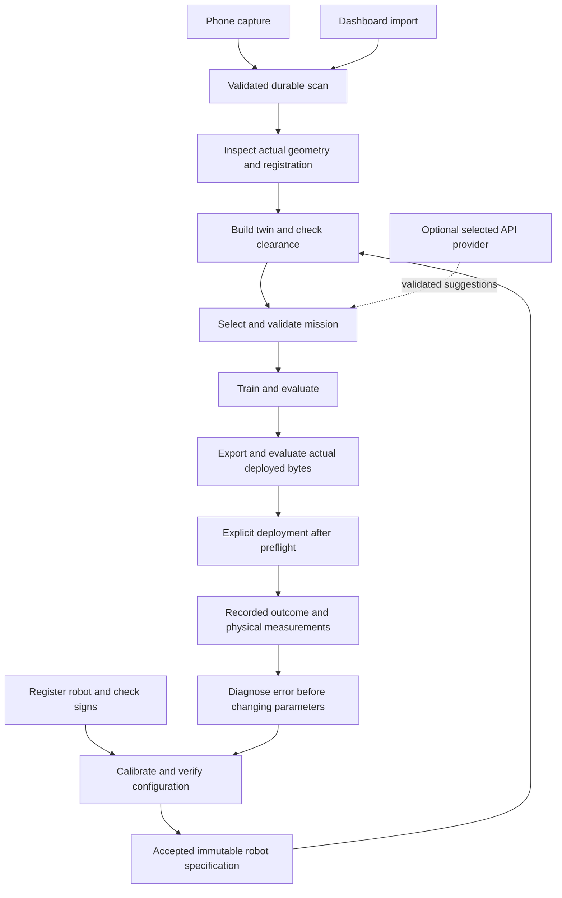

# ScanBorn — enhanced master plan

**Revision:** 18 September 2026 · **State:** implementation in progress  
**Companion:** [Execution checklist and evidence ledger](2026-09-18-execution-plan.md)

## 1. One product, one plan

Deliver a dependable workflow from a phone scan or dashboard import to an inspected reconstruction,
calibrated robot, validated mission, explicit deployment and measured result. Both dashboard and
Android must operate the same pipeline, display the same coordinates and explain refusals clearly.

This is the single current product and acceptance plan. Its companion is the single execution
checklist. Together they supersede the overlapping 17 September completion/shared-viewer plans
and 18 September cloud amendment for future work. Preserve those documents as historical evidence;
their unchecked lists and older test counts are not current status.

**Operating model:** local-first, cloud-capable. Local processing remains usable without external
APIs. Selected workloads may use explicitly configured API providers as primary or secondary
options. Provider outputs remain subject to the same deterministic validation. A service outage
must never disable rover Stop, E-STOP, heartbeat expiry or firmware sensor checks.

## 2. Scope and architecture

| Component | Responsibility | Boundary |
|---|---|---|
| Android `MOBILE-APP/` | ARCore capture, durable queue, native mission/calibration controls, local Qwen, shared viewer | Does not currently reconstruct and train the entire pipeline on the phone |
| Dashboard `dashboard/` | Upload, inspect, prepare mission, supervise, compare outcomes | Browser never receives provider secrets or directly controls motors |
| Orchestrator and CPU stages | Store/validate inputs, reconstruction, twin, planning, simulation, export, persistent jobs | Own artifact lineage, idempotency, provider policy and deployment preflight |
| Shared Three.js viewer | Geometry, true-scale rover, selection, layers and replay | Presentation only; renderer failure leaves native/web status and stop controls usable |
| Optional provider adapters | Language planning/profiling; separately qualified export/compute services | Explicit workload selection, bounded requests, actual-provider provenance |
| ESP32 rover / fake rover | Execute supported controller, odometry, calibration state machine, limits and stops | No cloud or language-model dependency inside the control loop |

Supported inputs are ARCore depth/pose frames and supported PLY/OBJ geometry. Ordinary photos or
video do not become reconstructed geometry through the present importer. Keep the current CPU
pipeline and model. Remote reconstruction/training, generic hosted Qwen/local model servers and
accelerator deployment are extensions requiring their own compatibility proof. Unity/PPO, TSDF,
new model downloads, phone-mounted localisation, manipulation and voice-triggered missions remain
outside this delivery. Docker runtime verification stays separate. No commits/pushes by default.

## 3. Verified baseline and remaining work

Evidence below comes from recorded checks on 18 September or earlier; this planning revision
does not rerun or extend those measurements.

| Area | Present implementation/evidence | Remaining closure |
|---|---|---|
| Regression | 453 Python tests; 60 dashboard tests; production build; Android unit/debug/instrumentation APK builds passed | Repeat affected checks after edits; final firmware/CI/device/browser gates |
| Capture | Stable identity, bounded private disk queue, validation, atomic storage, partial completion | Fault matrix and actual phone lifecycle/model handoff proof |
| Pipeline | Immutable outputs, lineage, exported-int8 checks, jobs and deployment deduplication | Complete client unknown-outcome recovery and readiness gating |
| Specifications | Accepted revisions bound through twin/train/export/deploy; reconciliation and crash-window tests | Multiple historical/uncertain-session edge cases and recovery UI acceptance |
| 3D | Actual RGB preview, dashboard imported faces, floor transform, detailed true-scale rover, disposal/context recovery | Android layer/result parity, phone performance and fresh responsive/browser checks |
| Android | Spaces, native mission/stop/calibration, physical registration and state restoration compile | Instrumented lifecycle, unknown-start outcome recovery, surface cache and result parity |
| Calibration | Async fake workflow, read-back/rollback, isolated simulated specs | Firmware fault-state coverage and physical measurements |
| Providers | Explicit local/Groq/Sarvam planner adapters; local/Groq profiler | Selection/export inconsistencies, strict validation, bounded and disclosed fallback |

Known warnings and limits: dashboard has a roughly 568 kB Three.js/RoomEnvironment chunk warning;
phone and physical-rover acceptance are open. Earlier desktop 500k rendering measured 14.1 ms p95
in its recorded setup; this is not a phone result or a guarantee across scenes. Eight mount/dispose
cycles had stable resource counts; that is not proof of no process-memory leak.

## 4. Non-negotiable data and state contracts

Every pipeline record carries its stable ID, schema version, parent IDs, creation time and actual
provenance. Artifacts carry immutable content identity/checksum. Robot specifications carry stable
spec ID, revision, snapshot, robot binding and measured/simulated/assumed provenance by parameter.
Display names and filesystem paths are never interchangeable with IDs.

Use metres, right-handed map coordinates, Z-up, explicit floor height and heading convention.
One tested map-to-render transform serves geometry, routes, picking and telemetry. Imports carry
declared units/up-axis and registration state; unknown registration permits inspection, not a
claim that the robot and scan share a physical frame. Rescans require same-marker confirmation
before invalidating an existing mission through spatial comparison.

Persist request IDs before mutation. Repeating the same request returns the same operation;
the same ID with different input is refused. Represent pending, running, succeeded, refused,
failed, interrupted and unknown outcomes distinctly. Reachable `/health` means reachable, not
ready to deploy. After restart, revalidate scan/twin/mission/spec/artifact/robot relationships;
never restart a drive automatically. Resolve an uncertain mutation by lookup, not blind retry.

Use additive migrations, explicit transactions, atomic file writes and bounded allocations.
Preserve old records and previous accepted configuration on failure. Test interruption before
and after each irreversible publication boundary. Keep recording failures visible even if the
rover action succeeded. Define retention and cleanup so no referenced artifact is removed.

## 5. Accuracy: measurable requirements, not a visual impression

Accuracy has four distinct layers: scene measurement, coordinate registration, controller
performance and physical ground truth. A good-looking model or small odometry error proves none
of the other layers. Store units, measurement method, instrument resolution, sample count,
environment, spec revision and whether each result is measured, reported, simulated or assumed.

| ID | Test and metric | Acceptance rule / status |
|---|---|---|
| A1 | Synthetic axes, floor, units and viewer/picking round-trip | Proposed numerical tolerance: 1 mm for deterministic fixture coordinates; no mirrored axes or dropped floor offset |
| A2 | Real 2 m phone axis walk | Existing diagnostic: along/sideways error <=0.15 m, initial heading <=10 degrees. A capture sanity check, insufficient to establish 10 cm drive accuracy |
| A3 | Real reconstructed dimensions | Proposed initial inspection target: error <=max(0.05 m, 2% of length) on at least 5 tape-measured spans across 3 scans; publish every sample and median/max |
| A4 | Physical marker placement/alignment | Measure repeated start placement and heading, compare with simulator assumptions; refuse the physical-ready label when actual uncertainty exceeds the validated envelope |
| A5 | Wheel calibration repeatability | Proposed: at least 3 valid straight trials and 3 spins in each direction; report individual residuals, spread and before/after results; no automatic acceptance of unstable estimates |
| A6 | Mission simulation | Preserve existing >=27/30 success gate within 0.10 m true simulated goal error; evaluate exported int8 bytes with the same mission/spec. Report collision, timeout and off-goal outcomes separately |
| A7 | Stronger release evaluation | Add held-out seeds and a fixed difficulty suite; proposed 100 runs per representative case, >=90% success, zero collisions in release acceptance. Version this stricter gate; do not silently redefine old results |
| A8 | Physical goal error | Proposed initial demo target: >=9/10 completed short-route trials within 0.10 m tape-measured radial goal error, zero collisions, no discarded failed attempts; report median/p95/max, not only success count |
| A9 | Square odometry report | Record reported closure, externally measured endpoint, orientation if measured, travel distance and stop reason; a 1 m square is a diagnostic, not guaranteed to pass the same short-route gate |
| A10 | Rendering performance | p95 frame time <=33 ms at 500k laptop / 100k S24 FE points; use the repeatable sequence in the execution plan |

A3–A5 and A7–A8 are proposed engineering acceptance targets, not current achievements or claims
of hardware feasibility. Small samples are demo evidence, not a statistical reliability guarantee.
Do not tune repeatedly on held-out seeds and still call them held-out. Keep training, tuning and
release scenarios separate; publish refused routes as well as successful runs.

Maintain an error budget covering map scale/floor uncertainty, marker placement, wheel scale,
wheelbase, slip, gyro bias and latency. Measure or bound each term; do not sum unrelated errors
as independent Gaussian noise without justification. Calibration of wheel geometry must not mark
slip, gyro bias or placement uncertainty measured. Use measured distributions or conservative bounds
in simulation. Preserve uncertainty when a new provider or reconstruction changes the scene.

Clearance must account for footprint and map/pose uncertainty. Unknown occupancy is not proven
free. Test narrow passages, low obstacles, unobserved areas and the current floor-band blind spot.
If uncertainty leaves no safe route, explain the refusal; do not shrink safety margins to pass.
When physical accuracy fails, diagnose registration versus odometry versus map error first; shorten
the supported route envelope or require a future localisation capability instead of claiming success.

## 6. API/cloud strategy and accuracy controls

| Workload | Local baseline | Permitted secondary scope |
|---|---|---|
| Android AI helpers | Bundled Qwen/llama.cpp | Future server-mediated provider adapter with equivalent task contract |
| Server intent | Keyword task planner | Existing Groq/Sarvam adapters after shared strict schema/target validation |
| Environment profile | Deterministic heuristic | Existing Groq profiler after correct transport failure handling and provenance |
| Geometry/twin/mission validation | CPU geometry and deterministic checks | Suggestions cannot override geometry or feasibility |
| Export | NPZ int8 on supported runtime | AI Hub/QAIRT experiments only after explicit selection and actual-format verification |
| Rover control | Local supported controller and firmware | No remote provider in motor, heartbeat or stop paths |

Persist requested and actual provider/model, execution location, model/schema version, input
identity, attempt history, fallback reason, latency and available usage. Keep full prompts/scene
content out of default logs; retain reproducibility metadata without credentials. Unknown usage
or cost remains unknown. Never describe Groq as on-device or local.

Default policy is local-only. An operator can choose an ordered provider chain per workload and
authorize its outgoing data scope once through settings. Keys alone do not activate networking.
Validate unknown providers early. Use request deadlines, limited retries/backoff, cancellation,
response-size limits, concurrency limits and configured spend ceilings. Exhaustion produces an
explicit failure/refusal. Paid jobs require idempotency or result lookup before retry.

Validate the whole graph/profile: schema, finite/ranged parameters, supported action, current
scene targets and relationships. Never silently drop invalid steps into a different mission.
Ambiguity requests clarification; fallback cannot invent the user's intent. No model-generated
text grants deployment authorization. Test provider quality on a versioned supported-intent set,
including ambiguous/unsupported/multilingual cases. Compare semantic correctness and refusal
accuracy separately from JSON validity; no untested language gets a multilingual quality claim.

Fix known seams first: unknown-name silent fallback; token-triggered AI Hub upload; QAIRT label
on an NPZ output; Sarvam target validation; Groq partial graph filtering; profiler transport and
actual-fallback reporting. A cloud export is not deployable until those exact bytes run in the
target runtime and pass validation. Keep raw scans local unless an explicit future job authorizes
their upload. Public server hosting additionally requires authentication, authorization, TLS and
resource limits; it is not implied by LAN operation.

## 7. Capture, rendering and client experience

Capture admission and upload are bounded and serialized. Finish closes admission before draining;
partial finish is explicit. Cancel, pause, interrupted tracking and restart preserve consistent
accepted/uploaded/pending/rejected/dropped counts. Release model ownership before AR capture;
reload on the next AI request. Do not delete the legacy capture app before real phone acceptance.

The workspace displays measured geometry immediately after reconstruction. Preserve original
geometry and valid imported faces; use deterministic 100k/500k previews. Semantic boxes, inferred
labels, occupancy and illustrative rover parts have distinct legends. True-scale rover dimensions
come from the bound specification. Offer Fit room, Inspect rover, Top, Perspective and Follow;
preserve camera position during telemetry, layer and state updates.

Finish shared layer/selection/dimension/point-size controls, native imported surfaces, timestamped
replay and explicit untimed legacy traces. Use bounded reusable geometry, correct color management,
restrained lighting and no bloom/SSAO requirement. Pause hidden/idle rendering, dispose all resources,
recover context loss and retain a useful 2D fallback. Native/WebView bridges remain origin-restricted,
bundled and limited to render data and selection events.

Dashboard puts the workspace first on narrow screens, collapses stage controls and preserves a
mission/result inspector. Android uses native touch controls and accessible labels. Both show
connection/readiness separately, preserve Stop/E-STOP outside the canvas, discover saved records
without copied IDs, restore the selected scene, label offline cache age, and disable mutations
until state reconciliation succeeds. Switching robots clears incompatible results and cannot
transfer an old robot's active session or calibrated provenance.

## 8. Delivery stages and dependencies

| Stage | Outcome | Depends on | Closure evidence |
|---|---|---|---|
| E0 | Baseline, lineage and calibration recovery closed | Existing implementation | Migration/crash-window/history tests; accepted spec used end to end |
| E1 | Explicit providers and truthful exports | E0 | No-call local tests, format/backend tests, strict provider failure matrix |
| E2 | Durable and interpretable capture/import | E0 | Queue/restart/race fixtures; units/registration and malformed-input refusals |
| E3 | Fully recovered client mission state | E0, E1, E2 | Lost-response/restart/robot-switch tests; readiness and stop independence |
| E4 | Shared 3D and outcome parity | E2, E3 | Same scene/picks/spec/results; resource/performance and fallback evidence |
| E5 | Calibration, firmware and accuracy evaluation | E0, E2, E3 | Fault-state tests; held-out evaluation; fake calibrated complete loop |
| E6 | Reproducible software release candidate | E1–E5 | All regressions, browser acceptance, builds and clean CI |
| E7 | Phone and measured physical acceptance | E6, available phone/rover | Real scans, phone performance, sign/calibration checks and tape-measured trials |

Follow the [execution checklist](2026-09-18-execution-plan.md) for files, tasks, tests and status.
Work may be interleaved when dependencies permit, but no stage closes on compilation alone.
Fix critical failures before cosmetic additions. Preserve historical artifacts and snapshots.

## 9. Completion rules

Each stage records changes, exact checks, environment, evidence paths, remaining defects and
acceptance status. Test passing means that test passed; skipped/inapplicable/device-unavailable
checks never become passes. Use `implemented`, `verified in software`, `verified on device`,
`blocked` and `not started` explicitly rather than one ambiguous “done”.

**Software complete:** E0–E6 evidence exists, both client workflows pass, local-only and configured
fallback failure modes are verified, and the calibrated fake-rover loop preserves provenance.
**Physical demo complete:** E7 additionally meets the stated measured envelope. A failed target
requires a recorded defect, justified scope change or further implementation—not a relaxed claim.
Neither state means every possible bug is eliminated or general autonomous navigation is solved.
